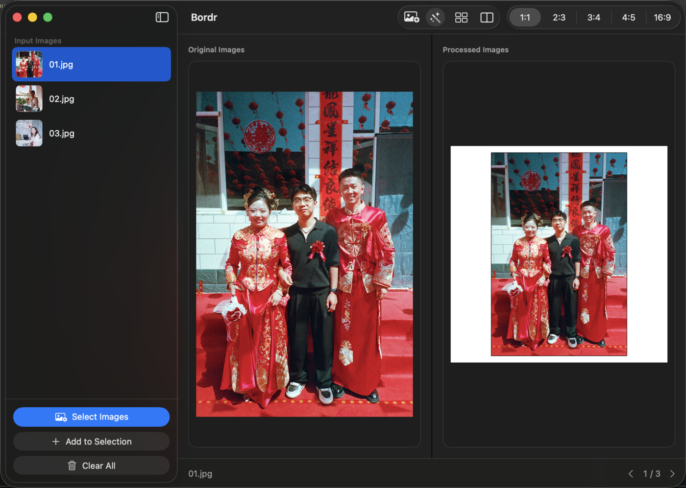
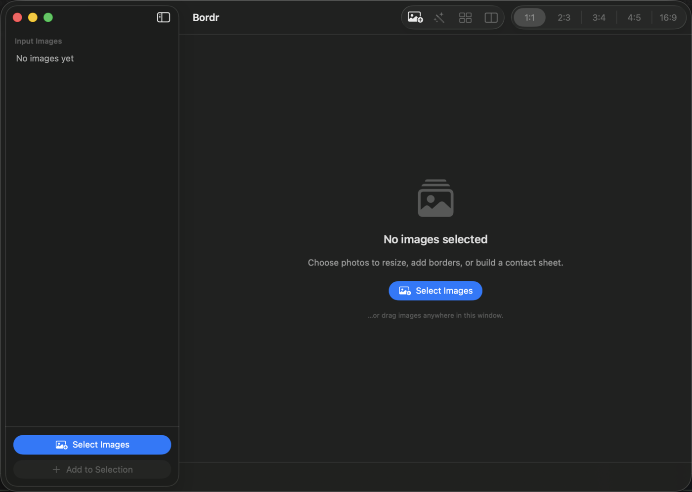
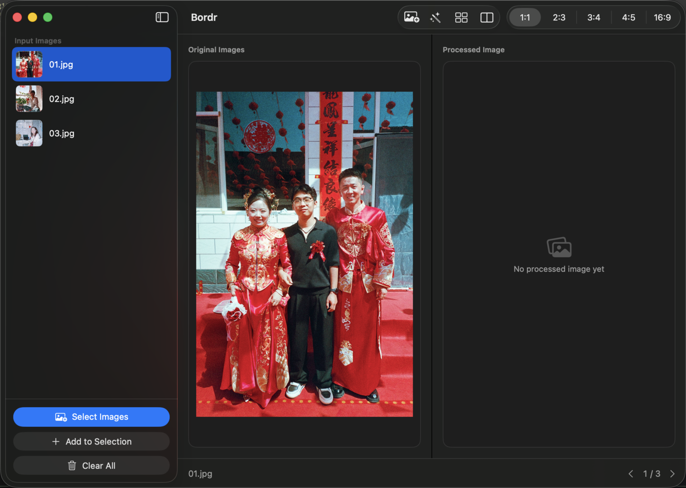
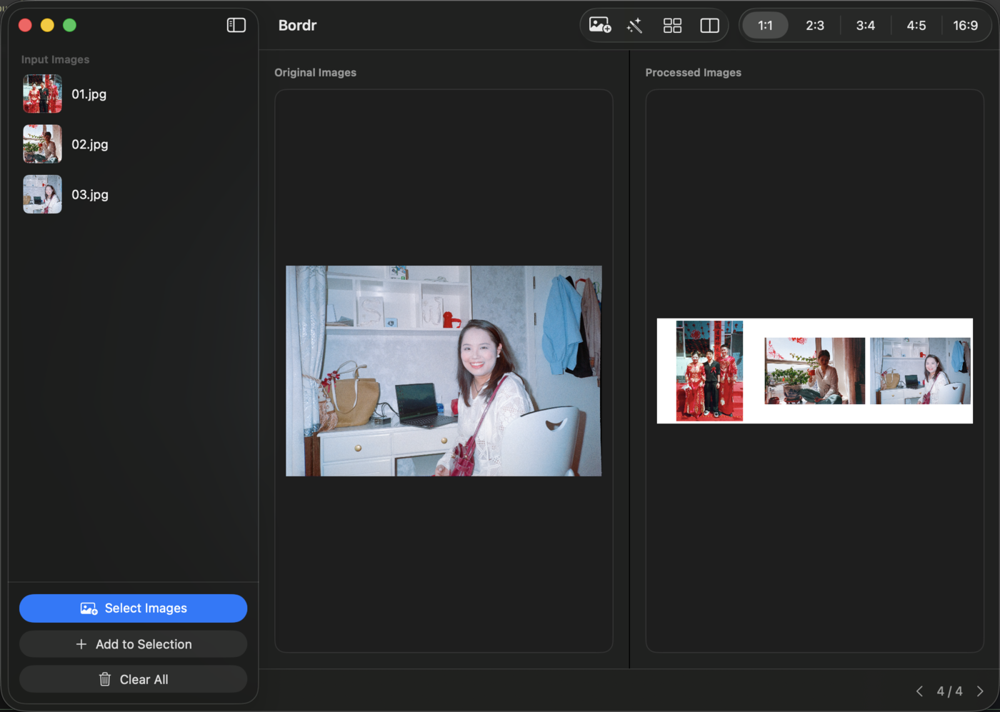

# Bordr

Bordr is a small macOS app for prepping photography for social media.
It is a SwiftUI front-end for [ImageMagick](https://imagemagick.org) that
resizes images, adds a thin border, and places each one on a fixed
aspect-ratio canvas in a few clicks.

## Features

- **Import** one or many images with **Select Images** (`⌘O`), or drag
  them straight into the window.
- **Process** every selected image onto a 1:1, 2:3, 3:4, 4:5, or 16:9
  canvas, centered on white with a thin black border (`⌘↩`).
- **Contact Sheet** combines two or more images into a single montage
  with a configurable background colour and optional per-image borders.
- **Process for Scroll** splits the current image into swipable halves
  sized to the selected aspect ratio (the "XHS" scroll trick).
- **Browse** with the on-screen chevrons or the `←` / `→` arrow keys.
  Navigation wraps around from the last image to the first, and vice
  versa.
- **Manage** the selection in the sidebar: drag to reorder, remove with
  the context menu, and clear everything at once.
- Output is written automatically next to each source file; there is no
  separate save step. Closing the window quits the app.

## Requirements

- macOS 15.4 or later.
- ImageMagick installed through Homebrew: `brew install imagemagick`.
  Bordr looks for `magick` at `/opt/homebrew/bin/magick`,
  `/usr/local/bin/magick`, then `/usr/bin/magick`.

## Usage

1. Click **Select Images**, or drag photos into the window.
2. Pick an aspect ratio from the toolbar.
3. Click **Process** to place every selected image on that canvas.
4. Optionally open **Contact Sheet** to build a montage, or **Process for
   Scroll** to split the current image into halves.
5. Navigate the results with the chevrons or the `←` / `→` arrow keys.

Processed files are saved beside their originals using these suffixes:

| Action | Output file |
| --- | --- |
| Process | `<name>_processed.jpg` |
| Contact Sheet | `<first>-<last>__collage.jpg` |
| Process for Scroll | `<name>_1.jpg`, `<name>_2.jpg`, … |

## Screenshots

On launch

After selecting images

After processing (1:1 canvas)

After building a contact sheet

## Version History

### Version 2.4

A full UI pass and quality-of-life update.

#### What's New

- New sidebar + editor layout built on `NavigationSplitView`, with a
  thumbnail list, drag-and-drop import, and inline actions.
- A real toolbar for Select, Process, Contact Sheet, Process for Scroll,
  and the aspect-ratio picker.
- Responsive before/after previews that scale with the window instead of
  fixed-size frames.
- Arrow-key navigation (`←` / `→`) with wrap-around, plus working
  chevrons.
- Sidebar support for removing, reordering, and clearing images.
- Closing the window now quits the app.

#### Fixes

- Processed filenames are now derived correctly for PNG and TIFF inputs.
- Changing the aspect ratio and processing again re-renders instead of
  reusing a stale cached output.
- Scroll output paths containing spaces are quoted correctly.
- Removed duplicated ImageMagick path lookups and console debug logging.

### Version 2.2

Version 2.2 added **Process for XHS** (now labelled *Process for
Scroll*), which halves an image, resizes each half, and places them on
separate canvases so they read as one continuous image when swiping
between posts. It also cleaned up the previous UI.
