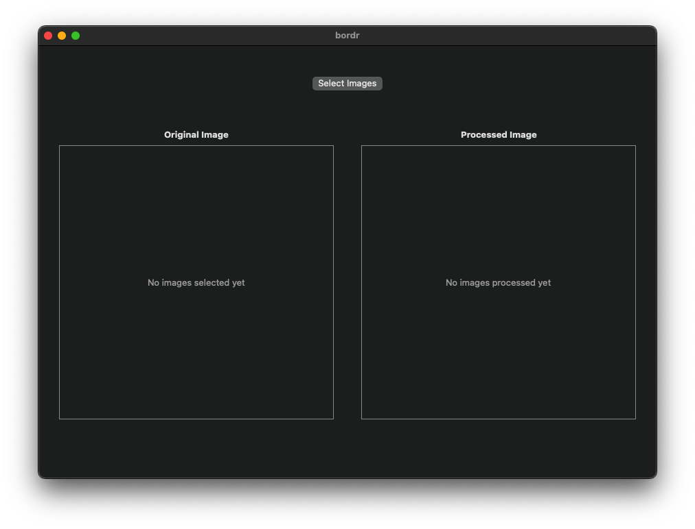
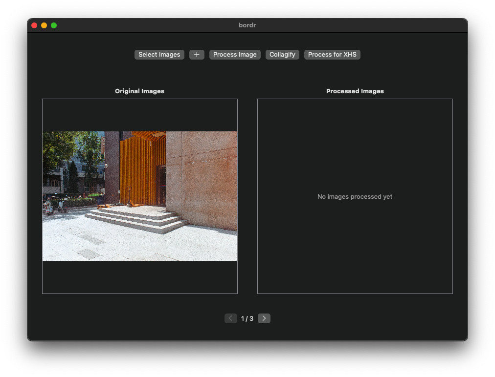
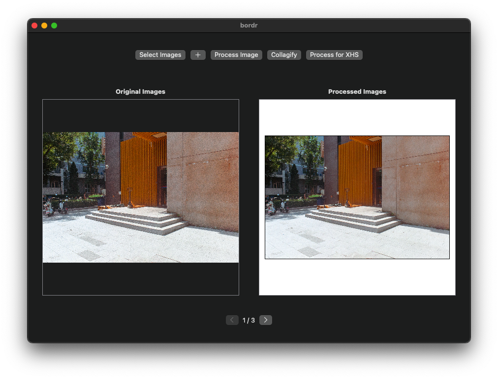
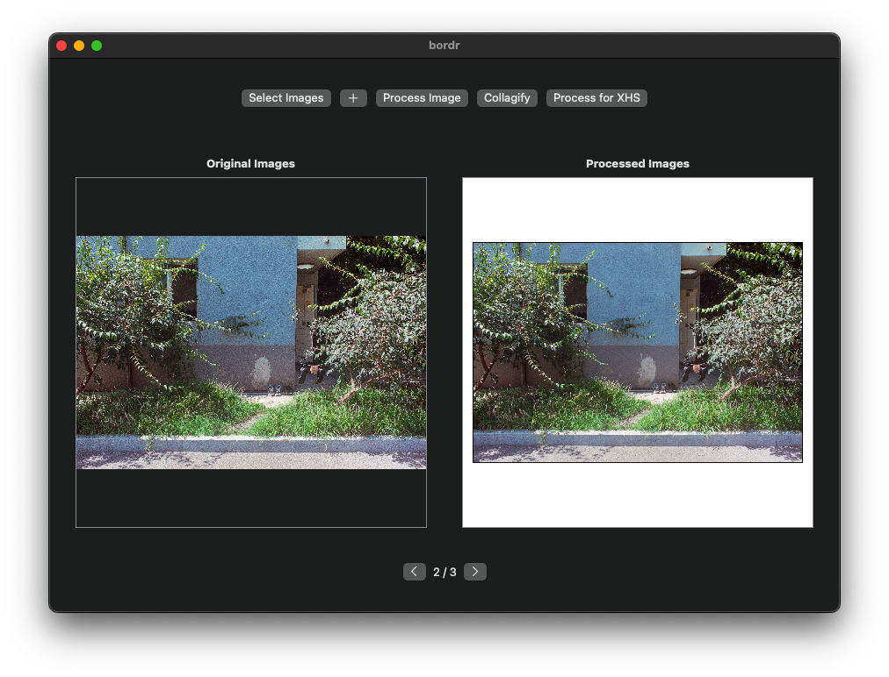
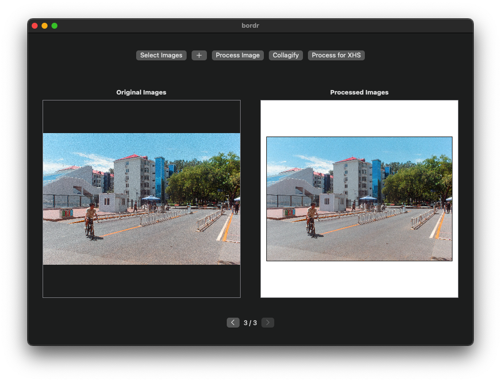
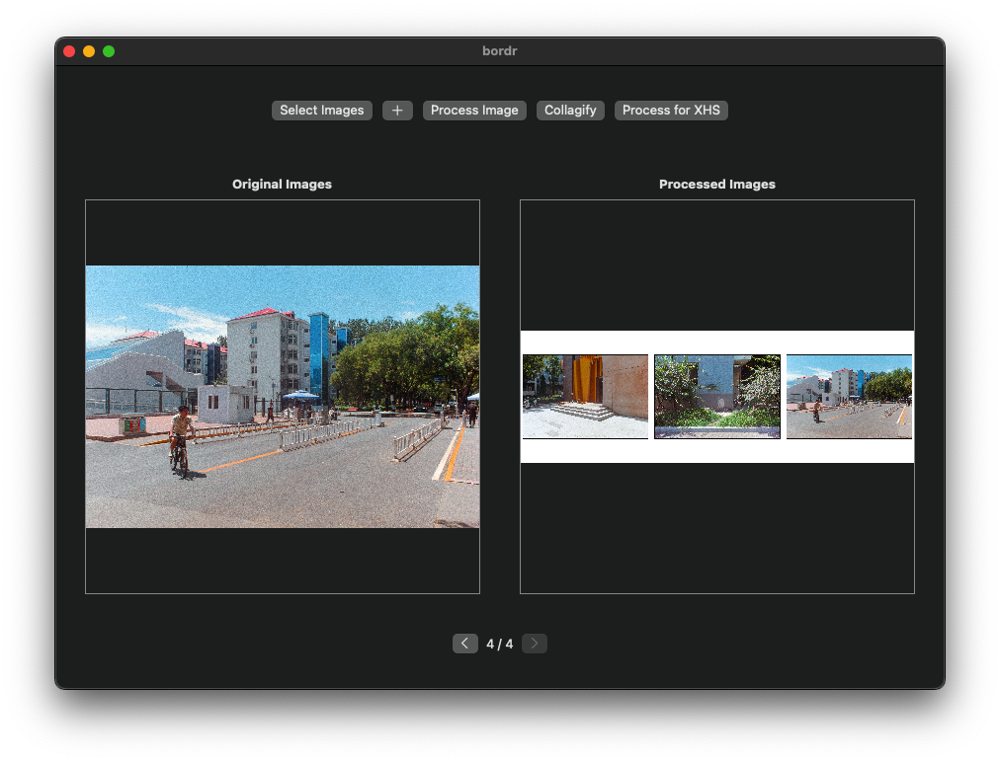
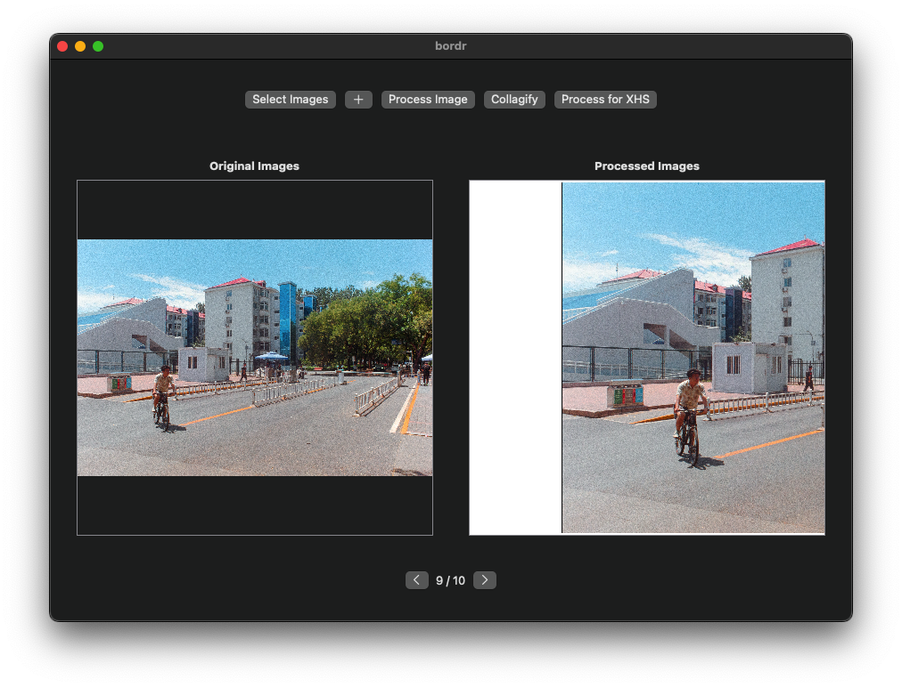

# Bordr

## Overview

At the moment, `Bordr` is a very simple graphical interface for
streamlining how I currently share my photography on social media.

It's basically a SwiftUI wrapper for ImageMagick commands that resize,
add borders and create collages of my images in a few clicks.

First, select the image(s) you wish to process. After selection, the
selected images will appear on the left in the `Original Image` or
`Original Images` image area. The current selection can be viewed using
the arrow keys that appear below.

To add images to the current selection, click the plus (`+`) button
next to `Select Images`. The added images will be placed before the
previous selection of images in the viewer.

To resize and place each image in the selection on a square canvas,
click the `Process Images` button. The processed images will be added
to the `Processed Image` or `Processed Images` image area upon
completion.

## Version History

### Version 2.2

Version 2.2 includes improvements to the overall look of the UI as well
as some known bug fixes and quality of life improvements.

#### What's New

##### `Process for XHS`

New in Version 2.2 is the ability to process individual images as
cropped halves using the `Process for XHS` button.

This effectively halves an image, resizes each half then places those
halves on separate 4096x4096 canvases in order to
'maximize the viewing quality' of the image on social media.

To be honest, I just thought the seamless transition when swiping
between images was cool. In the end, that's what this button comes down
to.

##### Other Changes

The UI is somewhat cleaner and less 'buggy' now with changes being made
to the appearance and components of the UI.

#### UI

On launch

Post `Select Images`

Post `Process Image`

Post `Collagify`

Post `Process for XHS`

